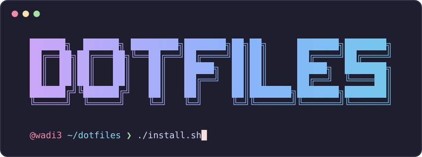

<p align="center">
  
</p>
<p align="center">
  My dev setup: Ghostty, zsh, Starship, Neovim and VS Code,<br>
  all in Catppuccin Mocha with JetBrainsMono Nerd Font.
</p>

## What's inside

Each folder is a [GNU Stow](https://www.gnu.org/software/stow/) package, laid out the way its files sit in `~`, so Stow can link them into place.

| Package                            | What it sets up                                                                                                      |
| ---------------------------------- | -------------------------------------------------------------------------------------------------------------------- |
| `zsh`                              | History, completion, autosuggestions, syntax highlighting, fzf, zoxide and a few aliases                             |
| `starship`                         | The prompt (Catppuccin Powerline)                                                                                    |
| `ghostty`                          | The terminal: theme, font, a drop-down quick terminal on `` Cmd+` `` and a notification when a long command finishes |
| `nvim`                             | [LazyVim](https://www.lazyvim.org), set up for TypeScript, Python, Tailwind, SQL, Docker and more                    |
| `vscode`                           | Editor settings (the extensions live in the `Brewfile`)                                                              |
| `git`                              | `.gitconfig`, with [delta](https://github.com/dandavison/delta) for diffs                                            |
| `bat` · `eza` · `lazygit` · `btop` | Catppuccin themes for the CLI tools                                                                                  |
| `mise`                             | Node LTS, Python and pnpm                                                                                            |

The `Brewfile` lists every app, font, CLI tool and VS Code extension, and `install.sh` puts it all together.

## Setting up a new machine

```bash
git clone https://github.com/EL-OUARDY/dotfiles.git ~/dotfiles
~/dotfiles/install.sh
```

The script installs `Homebrew` and everything in the `Brewfile`, links the configs with `Stow`, then installs the `mise` tools and the `Neovim` plugins. It's safe to run again whenever you like.

## Day to day

The configs are symlinks into this repo, so every change shows up in `git status`:

```bash
cd ~/dotfiles
git add -A && git commit -m "tweak ghostty" && git push
```

**New tool or app:** install it with `brew install`, then save it to the `Brewfile` from `~/dotfiles` with `brew bundle add <name>`.

**New config to track,** say `~/.config/foo`:

```bash
cd ~/dotfiles
mkdir -p foo/.config && mv ~/.config/foo foo/.config/ && stow foo
```

## Credits

[Catppuccin](https://catppuccin.com) for the colors, [LazyVim](https://www.lazyvim.org) for the editor and [GNU Stow](https://www.gnu.org/software/stow/) for the symlinks.

---

<br>

Crafted with ♥ and too much coffee by [Wadi3.codes](https://wadi3.codes)
